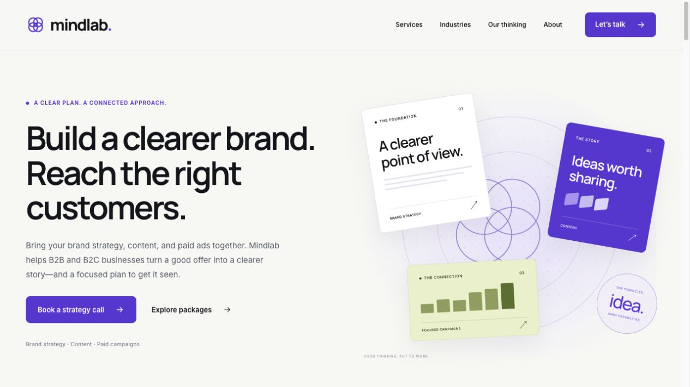

# Mindlab Solutions website

An original, static Astro marketing site based on the Mindlab agency guide and website planning workbook. This repository contains the website application at its root and the agency strategy, service guide, and website planning references in `docs/`. The local workspace checkout is the `site/` folder.

Source: **[jakerslam/Mindlab-Marketing](https://github.com/jakerslam/Mindlab-Marketing)** · [GitHub Pages preview](https://jakerslam.github.io/Mindlab-Marketing/) · [Private review](https://mindlab-solutions-review.jakerslam.chatgpt.site/) · [Content editor](https://mindlab-solutions.sanity.studio/)



## Planning and references

- [Agency strategy](docs/MINDLAB-STRATEGY.md)
- [Services, packages, and pricing](docs/MINDLAB-AGENCY-GUIDE.md)
- [Technology stack](docs/MINDLAB-TECH-STACK.md)
- [Integration architecture](docs/MINDLAB-INTEGRATION-ARCHITECTURE.md)
- [Implementation and launch status](docs/MINDLAB-BUILD-STATUS.md)
- [Website plan and reference websites workbook](<docs/Mindlab Website Plan and References.xlsx>)
- [Agency guide Word export](<docs/Mindlab Solutions Agency and Service Guide.docx>)

The Word guide and workbook are planning exports. The current Markdown notes, application configuration, and published CMS records describe the latest implementation.

## Run locally

Use Node **24.22.1** (see `.nvmrc`). With nvm installed:

```sh
nvm use
npm ci
npm run dev
```

The terminal prints the local preview URL. `npm run check` checks Astro and TypeScript; `npm run build` generates `dist/`; `npm run verify` validates the generated pages and internal links. In an execution sandbox, set `ASTRO_TELEMETRY_DISABLED=1` to avoid writing Astro preferences outside the checkout.

## Current state

The site includes Home, Services, a dedicated Pricing page, a Who we help overview with separate B2B and B2C pages, About with a condensed Our thinking section, two expanded fictional demonstrations, three original practical guides, the call page, privacy information, and a 404. It includes a selective React cost calculator and a customized shadcn/ui Button. Content pages render static HTML; no React runtime is needed on the homepage. Fonts are self-hosted.

Pricing uses compact service rows and an optional, collapsed budget estimator. Existing package and estimator anchors remain supported. The header contains Services, Pricing, Who we help, and About. Services and Who we help open on desktop hover, with keyboard controls and tap-to-toggle mobile navigation; top-level dropdown arrows are omitted. About is a direct link to the combined page. Its Our thinking section has two short example cards, three guide links, and an optional briefing checklist. Full demonstrations and articles remain available; `/work/` redirects to `/about/#our-thinking`. Package names, industry names, fees, and scope continue to come from the published content records. Audience pages tailor the service applications, sample demonstration, guides, and call to action. Old industry overview bookmarks redirect to the corresponding audience page and sector.

The public site is hosted at **https://mindlab.solutions/** on GitHub Pages with HTTPS. It remains a public preview: `SITE_STAGE=preview` makes pages noindex and disallows crawling until the existing launch requirements are completed. `CONTENT_SOURCE=sanity` reads published content without a local fallback. The older owner-private review deployment is separate; its identity is in `.openai/hosting.json`.

The Tally inquiry form and Cal.com 30-minute event are connected through `src/integrations/project.ts`. Sanity project `o19f4dqg` contains 21 published content records in its public `production` dataset. The authenticated browser editor is deployed at https://mindlab-solutions.sanity.studio/. Accepted inquiry delivery, booking confirmation, the contact inbox, and final indexing remain unverified or incomplete. Personal profiles and public contact details were deferred by the owner for this editorial pass.

## Structure and replaceable integrations

- `src/domain/content.ts`: provider-independent, validated content models.
- `src/content/site.json`: the explicit local draft/seed, including proposed prices and sample disclosures.
- `src/content/index.ts`: selects the content source once per build.
- `src/integrations/sanity.ts`: the only Sanity query and record mapping.
- `src/integrations/config.ts`: configuration and truthful integration capabilities.
- `src/components/Analytics.astro`: consent-gated event wrapper; no tracking when unconfigured.
- `sanity.config.ts`, `studio/schema.ts`: separate authenticated browser editor.

Replacing a provider means implementing its boundary and migrating its records. It does not require redesigning the marketing pages. The current Tally integration is an iframe, not a made-up submission API. Booking is a hosted link and cannot claim confirmed meetings. Inquiry contents are never sent through the site's analytics wrapper. Keep private leads outside the website CMS and repository.

## Browser editing and publishing

Editor: **https://mindlab-solutions.sanity.studio/**. Sign in with an account authorized for project `o19f4dqg`. Sanity manages authentication; opening the editor does not grant someone permission to edit.

The `production` dataset contains 21 published records: settings, homepage introduction, 3 packages, 6 industries, 2 clearly labeled sample concepts, 3 practical guides, and 5 FAQs. The recovery importer uses `createIfNotExists` and preserves existing records. The source explicitly selects Sanity, and an invalid record or unavailable API stops the build.

To edit, open the appropriate content group, change the fields, and publish. Package amounts and setup fees feed the cards, detailed service pages, and combined estimates from the same records. Stable IDs and slugs must be preserved.

**Published CMS changes need a website rebuild and redeployment to appear on the public site.** Use GitHub Actions → Deploy GitHub Pages → Run workflow after publishing. Automatic CMS-triggered rebuilds are not connected yet. The public site is static, so a Sanity Publish action alone does not update already-deployed HTML.

For local editing use `npm run studio`. To update the hosted editor's code or schema, use `npm run studio:deploy`; `sanity.cli.ts` retains the actual deployment app ID. The deployed schema and manifest are registered with Sanity. Hosted Studio access and CORS are handled by Sanity hosting; localhost:3333 remains allowed for local editing.

The importer is available for recovery or a new dataset: `npx sanity login`, then `npm run content:import:session`. It preserves existing records, including edits. The optional token-based importer uses only an ignored environment file; no write token belongs in the repository or public website build.

The editor covers the introduction, package facts, industry entries, sample narratives and deliverables, proposed measurement, practical guides, and FAQs. Guide slugs generate `/thinking/<slug>/` pages. Layouts and other page copy live in code. Verified client case studies need a future evidence-model extension. Export the dataset and assets before a CMS migration. Keep private leads outside this public dataset.

The November editorial migration used `scripts/update-editorial-content.mjs`: first `--plan /absolute/plan.json`, then `--apply` the reviewed plan through `sanity exec --with-user-token`. It rejects intervening record revisions and drafts, creates new guides atomically, and never changes package records. Routine editing should use Studio rather than rerunning a migration.

## Connect inquiries and scheduling

1. The supplied live Tally form is `https://tally.so/r/zEN7DM`. It requires full name, company, and email, with optional phone and context about brand strategy, ads, and content. The privacy text matches these actual fields. Suggested follow-up: add a primary-goal question, a `service` hidden field to record package interest, and the final privacy link. The official widget forwards the selected package query; recording it requires that hidden field in Tally.
2. Configure the owner notification recipient and a genuine completion message. Use the form provider's own accepted-submission and error behavior; do not redirect to an unverified success page. Retain Tally branding on the free tier.
3. Put only the form ID in `PUBLIC_TALLY_FORM_ID`. The site provides an embed and a hosted-form fallback link. Inspect the actual form at mobile and desktop sizes; adjust its height if needed.
4. The supplied booking event is `https://cal.com/jacob-haslam-zfpxbo/30min`. Its duration is 30 minutes, with America/Denver availability verified. The site now uses 30-minute call copy from shared configuration. The booking-link boundary can support another scheduler later.
5. Set `PUBLIC_CONTACT_EMAIL` to a verified monitored inbox. Do not invent an address.
6. Send a clearly marked test inquiry with authorization, verify it exists in the Tally dashboard and that the owner notification arrives, then verify the live calendar's availability/timezone. Check invalid input, retry behavior, retained entries, completion, and package-interest handoff.

Until these checks pass, inquiry delivery and confirmed scheduling remain unverified. The site deliberately has no false success state.

## Optional analytics

Set `PUBLIC_GTM_ID` only after configuring the actual container. The script loads after explicit consent and stores a versioned preference. Declining does not load GTM. Changing a granted choice to decline reloads the page without GTM. Review the actual tags and relevant cookie retention/deletion behavior before launch. Enabling the wrapper does not itself configure GA4, advertising tags, or consent behavior for those tags.

Allowed site events: `strategy_call_click`, `package_interest`, `booking_link_opened`. `inquiry_accepted` and `booking_confirmed` are **not** emitted because the current iframe/link adapters do not verify those outcomes. Set up and test provider-supported confirmation tracking before reporting them. No field values, emails, URLs, or query strings are included in the site's event payloads.

## Hosting and production release

GitHub Pages hosts the public preview at **https://mindlab.solutions/**. The custom domain and HTTPS are connected. Final production approval and indexing are still pending. The output remains portable static files.

For a host connected to this GitHub repository: use the repository root, build command `npm run check && npm run build && npm run verify`, output directory `dist`, and Node `24.22.1`.

For preview deployments use `SITE_STAGE=preview`. For production set the real provider configuration, `CONTENT_SOURCE=sanity`, `SITE_STAGE=production`, and `LAUNCH_CONTENT_APPROVED=true` **after** the owner reviews prices, scope, terms, sample disclosures, business/contact information, privacy and retention practices, and the original visual direction. Do not flip the flag simply to bypass the gate.

```sh
node --env-file=.env scripts/check-release.mjs
npm run check
npm run build
npm run verify
```

Review the generated site, test real inquiry delivery and calendar availability, then connect the custom domain. Ensure the production build allows indexing, generates the correct canonical URLs and sitemap, and uses a CMS publish hook for updates. `SITE_URL` can be supplied as a host environment variable; it defaults to `https://mindlab.solutions`.

The production gate validates configuration, not external service ownership or delivery. Manual provider checks are still required. The separate private review uses a Sites source repository and deployment. The public site uses jakerslam/Mindlab-Marketing, with its custom domain and HTTPS configured. The source and static output remain portable.

## GitHub Pages deployment

`.github/workflows/pages.yml` builds and deploys on pushes to `main`. It also supports **Actions → Deploy GitHub Pages → Run workflow**, which rebuilds the current published Sanity content without needing a code change. The workflow uses GitHub's built-in ephemeral token; no personal access token or Sanity write token is required.

Pages is configured to publish the root of `codex/pages-static`. The workflow reads the actual origin and repository base path from `actions/configure-pages`, uses Node from `.nvmrc`, installs the lockfile, checks types, builds from Sanity, verifies the output, and updates the static branch. If the same static commit is already published, it finishes without requesting another Pages build. If that commit is already building, it waits for the existing build. Otherwise it requests a build with the built-in repository token. Publication checks wait up to eight minutes for the exact static commit. Official action releases are pinned to their commit SHAs. The unused Webpack starter workflow is disabled; its file is retained.

**Keep editable code on `main`. Do not merge `codex/pages-static` into `main`; that branch contains only generated files.** An accidental merge was reversed with a normal revert commit so all history and the source were preserved.

This is a public **preview** with `SITE_STAGE=preview` and noindex metadata. A domain launch still requires the existing content/contact approval gates. CMS publication does not automatically dispatch this workflow yet; use the manual Run workflow action after publishing until a supported publish hook is configured.

For an equivalent local build:

```sh
SITE_URL=https://jakerslam.github.io SITE_BASE=/Mindlab-Marketing npm run build
SITE_BASE=/Mindlab-Marketing npm run verify
```

For a custom domain, set the domain in GitHub Pages first, update DNS, and run this workflow again. It will rebuild with the domain root as its base and preserve the GitHub CNAME setting on the publishing branch. See [custom domain setup](docs/CUSTOM-DOMAIN.md).

`SITE_BASE=/` preserves root-domain hosting. The route helper applies the prefix to navigation, form handoff, work links, and the favicon. Sanity, Tally, and the booking calendar remain provider-independent configuration.

## Dependency maintenance

Versions and lockfile are pinned. Targeted npm overrides patch transitive CMS CLI dependencies without downgrading Sanity. Recheck these when upgrading; remove them when the upstream ranges resolve patched versions. Build and check after a dependency change. shadcn/ui's Button pattern is MIT licensed; see `THIRD-PARTY-NOTICES.md`.

Official implementation references: [Astro](https://docs.astro.build/), [Tailwind with Astro](https://tailwindcss.com/docs/installation/framework-guides/astro), [shadcn with Astro](https://ui.shadcn.com/docs/installation/astro), [Sanity with Astro](https://docs.astro.build/en/guides/cms/sanity/), [Tally embeds](https://tally.so/help/embed-your-form).
